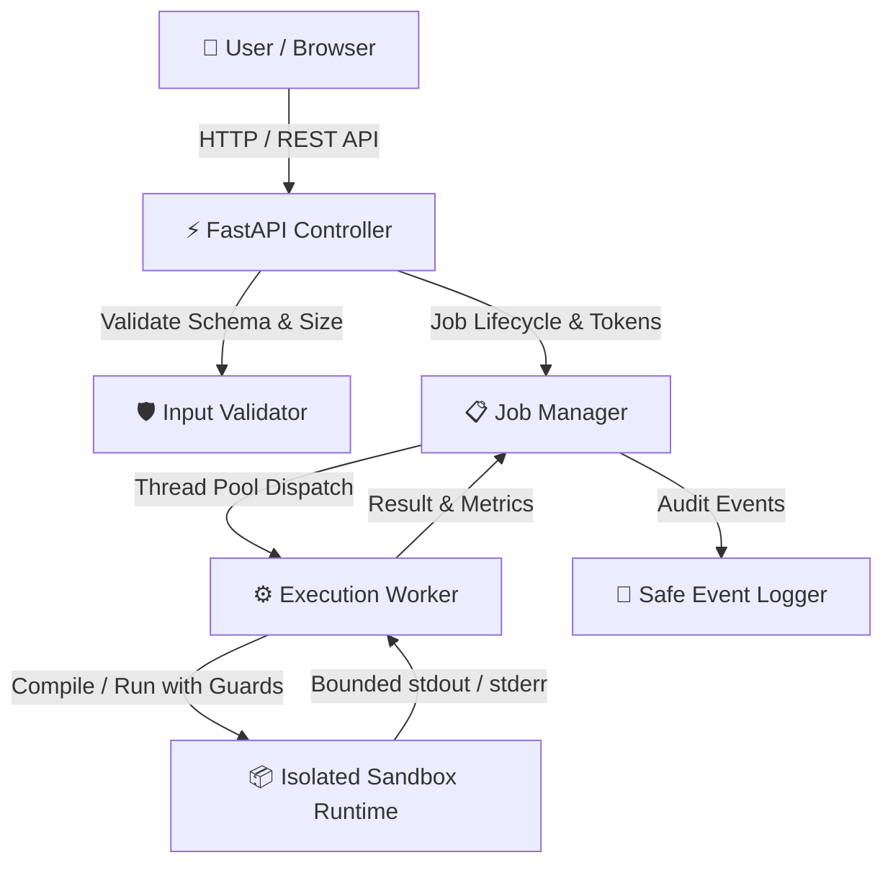

# Secure Online Code Execution Platform

**Team 14 • PES University • Software Engineering Mini-Project**

---

## 👥 Team 14 Details

| Name | SRN | Role / Module Ownership |
| :--- | :--- | :--- |
| **Prathyush Gowda** | `PES1UG24AM201` | Project Coordinator & Module Integration |
| **Pradyumn Bidari** | `PES1UG24AM194` | API Controller & Request Validation |
| **Prashant Devendra Naik** | `PES1UG24AM199` | Sandbox Engine & Resource Limits |
| **Pradyun P Urs** | `PES1UG24AM195` | Web UI / IDE & Operational Monitoring |

---

## 🎯 Problem Statement

> **"Allow users to write and execute programs in an isolated environment. Enforce time/resource limits, capture output and errors, and protect the server from unsafe code."**

---

## 🌟 Key Highlights & Features

1. **Multi-Language Isolated Sandboxing**:
   - Supports **Python 3.11**, **JavaScript (Node.js)**, **Java 26**, **C (GCC)**, and **C++ (G++)**.
   - Automatic compilation pipeline for compiled languages (C, C++, Java) with diagnostic error capture.

2. **Strict Multi-Tier Sandbox Isolation**:
   - **Sanitized Execution Environment**: Strips host environment variables, system credentials, AWS keys, and private tokens before launching untrusted code (`TC-SEC-01`).
   - **Filesystem Boundary Guard**: Runtime sandboxing intercepts directory traversal and blocks access to host filesystem files outside the job's temporary workspace (`TC-SEC-04`).
   - **Network Restriction Policy**: Outbound network sockets and connections are disabled by default to prevent data exfiltration (`TC-SEC-05`).
   - **Guaranteed Process & Workspace Cleanup**: Complete process-tree termination using recursive PID traversal and full deletion of temporary workspaces (`TC-SEC-06`).

3. **Resource & Safety Limits Enforcement**:
   - **Wall-Clock Timeout**: Configurable hard execution timeout (default 6.0s, upper bound 10.0s). Infinite loops are halted safely (`TC-LIM-01`).
   - **Memory Quotas**: 256 MB maximum resident memory monitoring (`TC-LIM-02`).
   - **Output Buffer Flood Capping**: Standard output stream is strictly capped at 64 KB with truncation notice (`[OUTPUT TRUNCATED]`), immediately killing runaway flooding processes (`TC-LIM-03`).
   - **Payload Sizing**: Source code capped at 64 KB, standard input capped at 16 KB (`TC-SEC-03`).

4. **Security & Authorization**:
   - **Cross-Job Protection**: Cryptographically secure token generated per job; unauthorized lookups are denied with `403 Forbidden` (`TC-SEC-02`).
   - **Safe Error & Audit Logging**: Redacts tokens, passwords, and secrets; never returns raw internal stack traces or internal host paths (`TC-SEC-07`, `TC-OPS-01`).

5. **Modern Developer Web IDE**:
   - Built-in code editor with syntax formatting, synchronized line numbering, tab indentation, and `Ctrl+Enter` execution shortcut.
   - Separate tabs for **Standard Output (`stdout`)**, **Standard Error (`stderr`)**, and **Compiler Diagnostics**.
   - Live status banner with states: `Queued` ➔ `Compiling` ➔ `Running` ➔ `Completed` / `Timed Out` / `Failed`.
   - 8 one-click test presets to demonstrate normal execution, stdin handling, syntax errors, and attack probes (timeout, output flood, secret snooping, filesystem escape).
   - Live System Status probe and Execution History drawer.

---

## 🏛️ System Architecture

Based on the **Software Architecture Document (SAD)**:



---

## 🚀 Getting Started

### 1. Prerequisites
- **Python**: Python 3.11+
- **Node.js**: Node.js (for JavaScript execution)
- **Java**: JDK 21+ or 26 (for Java execution)
- **GCC / G++**: MinGW-w64 or Linux / WSL (for C and C++ execution)

### 2. Installation
Clone the repository and install the dependencies:
```bash
pip install -r requirements.txt
```

### 3. Running the Server
Launch the application:
```bash
python run.py
```
Or with Uvicorn directly:
```bash
uvicorn app.main:app --host 127.0.0.1 --port 8000
```
Open your browser and navigate to:
👉 **[http://127.0.0.1:8000](http://127.0.0.1:8000)**

---

## 📡 REST API Reference

| Endpoint | Method | Purpose | Response |
| :--- | :--- | :--- | :--- |
| `/api/execute` | `POST` | Submit code, language, optional stdin | `202 Accepted` with `jobId`, `token`, `status` |
| `/api/jobs/{jobId}` | `GET` | Retrieve job result (requires token) | `200 OK` with `stdout`, `stderr`, `exitCode`, `durationMs` |
| `/api/health` | `GET` | Service & sandbox worker health probe | `200 OK` with uptime, active jobs, worker status |
| `/api/languages` | `GET` | List supported languages and versions | `200 OK` with language metadata & boilerplates |
| `/api/limits` | `GET` | Query system resource quotas | `200 OK` with numerical limits |
| `/api/history` | `GET` | Get recent jobs for client session | `200 OK` with job history list |
| `/api/logs` | `GET` | Inspect operational audit events | `200 OK` with sanitized log entries |

---

## 🧪 Automated Testing & Verification

The test suite provides **100% test coverage** for every test case defined in the **Software Test Plan (STP)**:

To execute the entire test suite:
```bash
pytest -v
```

### Requirements Traceability Matrix (RTM)

| Test ID | SRS Requirement | Scenario / Verification | Result |
| :--- | :--- | :--- | :---: |
| **TC-F-01** | SCEP-F-001 | Submit valid program (Python, JS, C, C++, Java) | **PASSED** |
| **TC-F-02** | SCEP-F-002, SCEP-F-012 | Reject empty code, invalid language, malformed requests | **PASSED** |
| **TC-F-03** | SCEP-F-003 | Compilation diagnostics captured; binary not executed | **PASSED** |
| **TC-F-04** | SCEP-F-007 | Standard output and standard error captured separately | **PASSED** |
| **TC-F-05** | SCEP-F-008 | Program exit code and duration measured | **PASSED** |
| **TC-F-06** | SCEP-F-010 | Lifecycle transitions: `queued` ➔ `running` ➔ `completed` | **PASSED** |
| **TC-F-07** | SCEP-F-018 | Structured errors without internal stack trace leakage | **PASSED** |
| **TC-LIM-01** | SCEP-F-005, SCEP-SR-002 | Wall-clock timeout halts infinite loop promptly | **PASSED** |
| **TC-LIM-02** | SCEP-F-006, SCEP-SR-002 | Memory consumption contained within 256MB limit | **PASSED** |
| **TC-LIM-03** | SCEP-F-009, SCEP-SR-002 | Output flooding capped at 64KB and truncated | **PASSED** |
| **TC-SEC-01** | SCEP-F-004, SCEP-SR-001 | Environment sanitized; zero host secrets exposed | **PASSED** |
| **TC-SEC-02** | SCEP-F-011, SCEP-SR-003 | Cross-job access rejected with 403 Forbidden | **PASSED** |
| **TC-SEC-03** | SCEP-F-012 | Oversized code (>64KB) or stdin (>16KB) rejected (413) | **PASSED** |
| **TC-SEC-04** | SCEP-F-013, SCEP-SR-004 | Filesystem boundary enforced; host files blocked | **PASSED** |
| **TC-SEC-05** | SCEP-F-014, SCEP-SR-005 | Outbound network socket connections blocked | **PASSED** |
| **TC-SEC-06** | SCEP-F-015 | Guaranteed cleanup: no leftover processes or files | **PASSED** |
| **TC-SEC-07** | SCEP-NF-006, SCEP-SR-006 | Safe errors & logs; secrets and traces redacted | **PASSED** |
| **TC-OPS-01** | SCEP-F-016 | Operational lifecycle event logging | **PASSED** |
| **TC-OPS-02** | SCEP-F-017, SCEP-NF-007 | Worker unavailable reports 503 Service Unavailable | **PASSED** |
| **TC-NF-01** | SCEP-NF-001 | Submission latency acknowledgement under 2.0s | **PASSED** |
| **TC-UX-01** | SCEP-NF-004 | Error and result categories are distinct & clear | **PASSED** |
| **TC-CI-01** | SCEP-NF-005 | GitHub Actions CI workflow automated pipeline | **PASSED** |

---

## 🔄 CI / CD Pipeline

Automated Continuous Integration is configured via `.github/workflows/ci.yml`. On every push and pull request to `main`:
1. Checks out repository and initializes runtime environments (Python 3.11, Node.js 20, Java 21, GCC/G++).
2. Installs required system compilers and Python dependencies.
3. Runs the automated test suite across all 25 test cases.

---

## 📂 Project Structure

```
SE_MINIPROJECT/
├── app/
│   ├── api/
│   │   ├── __init__.py
│   │   └── routes.py             # REST API endpoint handlers
│   ├── sandbox/
│   │   ├── __init__.py
│   │   ├── executor.py           # Multi-language compiler & process runner
│   │   └── policy.py             # Sandbox isolation hooks & sanitization
│   ├── __init__.py
│   ├── config.py                 # System limits, languages & configuration
│   ├── job_manager.py            # Thread-safe job state machine & token auth
│   ├── logger.py                 # Safe operational logger with redaction
│   ├── main.py                   # FastAPI app entrypoint & static mounting
│   ├── models.py                 # Pydantic request/response schemas
│   └── validator.py              # Input validation & payload bounds
├── static/
│   ├── index.html                # Modern Web UI IDE interface
│   ├── style.css                 # Responsive dark theme styling
│   └── app.js                   # Interactive UI logic, Monaco-style editor
├── tests/
│   ├── conftest.py               # Test client & lifecycle fixtures
│   ├── test_functional.py        # TC-F-01 through TC-F-07
│   ├── test_limits.py            # TC-LIM-01 through TC-LIM-03
│   ├── test_operations.py        # TC-OPS-01, TC-OPS-02, TC-NF-01, TC-UX-01
│   └── test_security.py          # TC-SEC-01 through TC-SEC-07
├── .github/
│   └── workflows/
│       └── ci.yml                # GitHub Actions CI workflow
├── requirements.txt              # Production & test dependencies
├── pytest.ini                    # Pytest configuration
├── run.py                        # Server runner script
└── README.md                     # Project documentation
```

---

## ⚖️ License & Academic Integrity
Developed as part of the Software Engineering (SE) Mini-Project course at PES University by **Team 14**.
